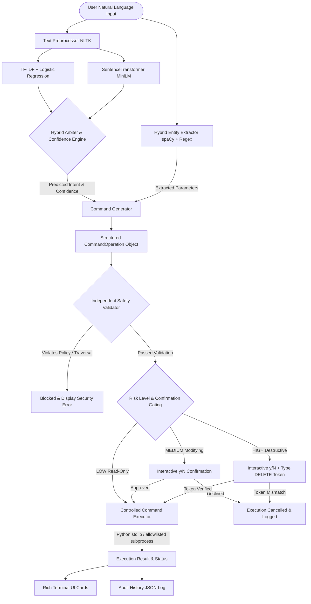

# AI Terminal Assistant: An Intelligent, NLP-Based Command Assistant for Windows PowerShell

**Project Report & Comprehensive Architecture Documentation**  
**Environment:** Windows 10/11 • Python 3.11.9 • Windows PowerShell  
**Repository Location:** `D:\AI Terminal Assistance`

---

## 1. Project Title
**NLP-Based Intelligent Terminal Command Assistant for Windows PowerShell**

---

## 2. Abstract
Command-line interfaces (CLIs) are fundamental to systems administration, software development, and DevOps automation. However, terminal command syntax—particularly within Windows PowerShell—is often verbose, cryptic, and prone to syntax errors or accidental execution of destructive operations. This project designs and implements an intelligent, natural-language-driven terminal assistant that translates plain English instructions into structured, validated Windows PowerShell operations. 

Unlike naive LLM or API wrapper approaches that directly execute unchecked shell strings, this system implements a modular, hybrid Natural Language Processing (NLP) architecture comprising NLTK preprocessing, TF-IDF feature extraction, Logistic Regression intent classification, Sentence Transformer dense embeddings (`all-MiniLM-L6-v2`), spaCy EntityRuler pattern matching, and deterministic regex. Crucially, generated PowerShell commands serve as informational previews only; authoritative execution is enforced through an independent security validator and native Python standard-library handlers (`pathlib`, `shutil`) operating within a workspace sandbox with multi-tier confirmation gating.

---

## 3. Problem Statement
1. **Steep CLI Learning Curve**: Novice developers, students, and cross-platform administrators frequently struggle with the syntactical complexities of PowerShell cmdlets (e.g., `-LiteralPath`, `-Recurse`, `Get-ChildItem`, `New-Item`).
2. **Catastrophic Shell Execution Risks**: Naive AI command generators generate raw shell strings passed to `shell=True` or `eval()`. A hallucinated path, wildcard misuse (`rm -rf *`), or unescaped parameter can lead to catastrophic system data loss.
3. **Command Injection & Directory Traversal**: Natural-language commands that contain special characters, semicolons, pipes, or relative traversal segments (`..\..\`) expose systems to command injection or system directory tampering.
4. **Vocabulary Mismatch & Paraphrasing**: Supervised classifiers trained purely on n-grams fail on unseen vocabulary and paraphrases, while heavy generative models introduce excessive latency and lack deterministic safety bounds.

---

## 4. Project Objectives
- **Natural Language Understanding**: Accurately classify user intent across 12 core terminal operation classes.
- **Robust Paraphrase Handling**: Combine supervised classification with dense semantic similarity to resolve diverse phrasing.
- **Parameter Extraction**: Reliably extract filenames, extensions, directory paths, tools, and search patterns with exact original casing and character offsets.
- **Independent Safety Validation**: Interpose a strict, independent security validator between NLP generation and execution.
- **Sandboxed Execution**: Enforce filesystem workspace containment, prevent directory traversal, block silent overwrites, and protect Windows system folders.
- **Multi-Stage Confirmation**: Require interactive `[y/N]` approval for state-modifying operations and double-confirmation (`DELETE` token) for destructive file deletion.
- **Clean Interactive Interface**: Deliver an interactive terminal interface using Rich with syntax previews, confidence metrics, and persistent audit logs.

---

## 5. Proposed Solution
The system employs a **Hybrid NLP & Dual-Layer Execution Architecture**:
- **Layer 1: NLP Interpretation**: Analyzes user queries using a two-stage hybrid engine. Supervised Logistic Regression provides fast decision boundaries, while Sentence Transformers rescue unseen paraphrases through semantic cosine similarity against verified training references.
- **Layer 2: Information Representation**: A rule-based generator constructs a typed `CommandOperation` Pydantic model with an informational PowerShell preview for display.
- **Layer 3: Independent Safety Validation**: A dedicated validator verifies parameter integrity, checks path safety against the sandbox root, blocks system directories (`C:\Windows`, `C:\Program Files`), and prevents file overwrite collisions.
- **Layer 4: Controlled Native Execution**: Filesystem operations are executed strictly via Python standard library calls (`pathlib.Path`, `shutil`), ensuring arbitrary shell execution is structurally impossible.

---

## 6. System Architecture

The overall system architecture and end-to-end processing pipeline are illustrated below:

---

## 7. Technology Stack

| Layer | Technology | Purpose |
|---|---|---|
| **Language** | Python 3.11.9 (64-bit) | Core runtime environment |
| **NLP Preprocessing** | NLTK 3.8+ | Tokenization, lemmatization, stopword normalization |
| **Supervised Learning** | Scikit-learn 1.4+ | TF-IDF Vectorizer & Multinomial Logistic Regression |
| **Semantic Embeddings** | Sentence Transformers (`all-MiniLM-L6-v2`) | Dense semantic similarity & paraphrase matching (384-dim) |
| **Entity Extraction** | spaCy 3.7+ (`en` blank model) & Regex | `EntityRuler` for runtime tools + regex for Windows paths/files |
| **Data Modeling** | Pydantic v2 | Strongly-typed schemas for operations, validation, & execution |
| **Terminal UI** | Rich 13.7+ | Formatted panels, syntax highlighting, tables, risk badges |
| **Testing** | Pytest 8.0+ | Automated regression test suite (185 test items) |
| **Operating Platform** | Windows 10/11 PowerShell | Target operational environment |

---

## 8. Dataset Description

The supervised intent classification model is trained on a dedicated dataset ([`data/intents_dataset.csv`](file:///d:/AI%20Terminal%20Assistance/data/intents_dataset.csv)):
- **Total Samples**: 240 natural language instructions.
- **Intent Classes**: Exactly 12 balanced classes (20 samples per class).
- **Split Ratio**: 80% stratified training split ($N=192$), 20% held-out test split ($N=48$).
- **Data Quality**: Verified via [`data/validator.py`](file:///d:/AI%20Terminal%20Assistance/data/validator.py) with zero duplicate entries, zero missing fields, and balanced class distributions.
- **Diversity**: Incorporates formal commands, colloquial paraphrases, questions, Windows backslash paths, extensions, spaces in names, and ambiguous out-of-scope queries in the `UNKNOWN` class.

| # | Intent Class | Example Training Query | Operation Type | Default Risk |
|---|---|---|---|---|
| 1 | `LIST_FILES` | *"list all files in the current directory"* | `LIST` | LOW |
| 2 | `CREATE_DIRECTORY` | *"create a folder named test_demo"* | `CREATE_DIR` | MEDIUM |
| 3 | `DELETE_FILE` | *"delete the file report.pdf"* | `DELETE` | HIGH |
| 4 | `SEARCH_FILES` | *"search for python scripts"* | `SEARCH` | LOW |
| 5 | `CHECK_VERSION` | *"check python version"* | `CHECK_VERSION` | LOW |
| 6 | `CURRENT_DIRECTORY` | *"what is the current working directory"* | `GET_LOCATION` | LOW |
| 7 | `MOVE_FILE` | *"move notes.txt to archive"* | `MOVE` | MEDIUM |
| 8 | `COPY_FILE` | *"copy data.csv to backup.csv"* | `COPY` | MEDIUM |
| 9 | `SYSTEM_INFO` | *"display computer system information"* | `SYSTEM_INFO` | LOW |
| 10 | `NETWORK_INFO` | *"show network adapter configuration"* | `NETWORK_INFO` | LOW |
| 11 | `CREATE_FILE` | *"create a new empty file called index.html"* | `CREATE_FILE` | MEDIUM |
| 12 | `UNKNOWN` | *"what is the weather like today"* | `UNKNOWN` | LOW |

---

## 9. NLP Pipeline Architecture

### 10. Text Preprocessing (`TextPreprocessor`)
- Custom regex tokenization preserving Windows paths (`C:\Data\file.txt`), relative paths (`.\folder`), file extensions (`.py`, `.pdf`), and numbers.
- WordNet lemmatization reducing inflections (e.g., *"listing"* $\rightarrow$ *"list"*, *"directories"* $\rightarrow$ *"directory"*).
- Selective stopword removal retaining crucial prepositions and spatial indicators (*"to"*, *"in"*, *"into"*).

### 11. Intent Classification (`IntentClassifier`)
- **Vectorization**: TF-IDF with sublinear term frequency scaling, character-boundary token patterns, and unigram/bigram feature extraction ($N$-gram range: 1–2).
- **Classifier**: Logistic Regression with L2 regularization ($C=1.0$, balanced class weighting, L-BFGS solver).
- **Held-Out Test Accuracy**: **83.33%** across 48 unseen test examples.

### 12. Semantic Similarity Engine (`SemanticEngine`)
- **Dense Embeddings**: Encodes inputs into 384-dimensional dense vectors using `sentence-transformers/all-MiniLM-L6-v2`.
- **Reference Utterances**: Evaluates cosine similarity against reference embeddings generated strictly from the 192 training samples (no test data leakage).
- **Hybrid Arbitration**:
  - **Consensus**: High classifier confidence + semantic match $\rightarrow$ `HYBRID_ENSEMBLE`.
  - **Paraphrase Rescue**: Classifier low confidence or `UNKNOWN` + semantic match $\ge 0.60$ $\rightarrow$ Rescues query using `SEMANTIC_ENGINE`.
  - **Mutual Uncertainty**: Classifier $< 0.35$ and semantic score $< 0.55$ $\rightarrow$ Safely classified as `UNKNOWN`.
- **Sparse Fallback**: Includes an offline TF-IDF cosine similarity engine for zero-dependency operation.

### 13. Entity Extraction (`EntityExtractor`)
- **spaCy `EntityRuler`**: Blank English model identifying canonical software runtimes (`Python`, `Node.js`, `Git`, `Docker`, `PowerShell`, `npm`, `Java`, `Rust`, `Go`, `GCC`, `Dotnet`, `Code`, `pip`).
- **Deterministic Regex**: Extracts absolute Windows paths, relative paths, filenames, extensions, quoted strings, and numeric counts.
- **Original Casing & Offsets**: Operates on raw, unmodified input strings to guarantee accurate Windows file casing.

---

## 14. Command Generation (`CommandGenerator`)
Constructs strongly-typed `CommandOperation` objects:
- Neutralizes wildcard injection by wrapping filesystem paths in `-LiteralPath`.
- Evaluates missing parameter completeness. Incomplete requests (e.g., *"move file"* without destination) transition to `GenerationStatus.NEEDS_CLARIFICATION` with human-readable prompts.
- Emits formatted PowerShell command strings strictly for user review.

---

## 15. Independent Safety Validation (`CommandValidator`)
Operates as a strict security barrier between generation and execution:
- **Sandbox Boundary**: Resolves paths against `config.WORKSPACE_DIR` (`D:\AI Terminal Assistance\workspace`). Any path attempting to escape (`..\..\Windows`) is flagged as `UNSAFE_PATH` (`TRAVERSAL_DETECTED`).
- **Protected Locations**: Blocks modification or deletion of Windows system roots (`C:\Windows`, `C:\Program Files`, `C:\ProgramData`).
- **Target Conflict Gating**: Detects if destination files/directories already exist for `CREATE_FILE`, `CREATE_DIR`, `MOVE_FILE`, or `COPY_FILE` (`CONFLICT_TARGET_EXISTS`), preventing silent data overwrite.
- **Search Pattern Sanitization**: Neutralizes illegal characters and command chaining symbols (`;`, `&`, `|`) in search patterns.
- **Allowlist Enforcement**: Validates executable names for version checks and system commands against hardcoded sets.

---

## 16. Controlled Command Execution (`CommandExecutor`)
- **No Arbitrary Shell Execution**: The generator's `powershell_preview` string is **never** executed.
- **Python Standard Library Filesystem Execution**:
  - `LIST` $\rightarrow$ `pathlib.Path.iterdir()` / `os.scandir()`
  - `CREATE_DIR` $\rightarrow$ `pathlib.Path.mkdir(parents=True, exist_ok=False)`
  - `CREATE_FILE` $\rightarrow$ `open(..., 'x')` (exclusive atomic file creation)
  - `DELETE` $\rightarrow$ `pathlib.Path.unlink()` (strictly checks `is_file()`; directory deletion prohibited)
  - `SEARCH` $\rightarrow$ `pathlib.Path.glob()` / `rglob()`
  - `MOVE` $\rightarrow$ `shutil.move()`
  - `COPY` $\rightarrow$ `shutil.copy2()`
  - `GET_LOCATION` $\rightarrow$ `pathlib.Path.cwd()`
- **Fixed Subprocess Execution**: System queries (`CHECK_VERSION`, `SYSTEM_INFO`, `NETWORK_INFO`) run via `subprocess.run(shell=False)` with explicit argument lists (e.g. `["python", "--version"]`), an explicit timeout (`COMMAND_TIMEOUT_SECONDS = 15`), and fallback to Python `platform.uname()` if CIM permissions are restricted.
- **Confirmation Architecture**:
  - LOW risk: Auto-executed.
  - MEDIUM risk: `[y/N]` interactive prompt (defaults to NO; only explicit `y`/`yes` proceeds).
  - HIGH risk: `[y/N]` interactive prompt AND exact confirmation token (`"DELETE"`).
- **Persistent Audit Logging**: Appends timestamped execution metadata, arguments, status, and duration to `data/command_history.json`.

---

## 17. Terminal User Interface (`TerminalUI`)
Powered by Rich:
- Styled application banners, welcome panels, and interactive help tables (`$help`).
- Color-coded risk badges: `LOW (Read-Only)`, `MEDIUM (State-Modifying)`, `HIGH (Destructive)`.
- PowerShell preview cards with prominent informational disclaimer.
- Execution outcome cards showing wall-clock duration in ms and the exact Python handler utilized.
- Formatted historical audit table (`$history`).

---

## 18. Experimental Results & NLP Evaluation

### Intent Classifier Held-Out Test Evaluation ($N=48$, 20% Split)

| Intent Class | Precision | Recall | F1-Score | Support |
|---|---|---|---|---|
| `CHECK_VERSION` | 1.0000 | 1.0000 | 1.0000 | 4 |
| `COPY_FILE` | 0.8000 | 1.0000 | 0.8889 | 4 |
| `CREATE_DIRECTORY` | 0.6667 | 1.0000 | 0.8000 | 4 |
| `CREATE_FILE` | 0.8000 | 1.0000 | 0.8889 | 4 |
| `CURRENT_DIRECTORY` | 0.6000 | 0.7500 | 0.6667 | 4 |
| `DELETE_FILE` | 1.0000 | 0.7500 | 0.8571 | 4 |
| `LIST_FILES` | 1.0000 | 0.5000 | 0.6667 | 4 |
| `MOVE_FILE` | 1.0000 | 0.7500 | 0.8571 | 4 |
| `NETWORK_INFO` | 0.7500 | 0.7500 | 0.7500 | 4 |
| `SEARCH_FILES` | 0.8000 | 1.0000 | 0.8889 | 4 |
| `SYSTEM_INFO` | 1.0000 | 0.7500 | 0.8571 | 4 |
| `UNKNOWN` | 1.0000 | 0.7500 | 0.8571 | 4 |
| **Overall Macro Average** | **0.8681** | **0.8333** | **0.8315** | **48** |
| **Overall Test Accuracy** | **83.33%** | — | — | **48** |

### Unseen Paraphrase Benchmark Evaluation ($N=36$ Queries)

A dedicated benchmark evaluated unseen phrasing across all 12 intents:

| Model Architecture | Top-1 Accuracy | Top-3 Accuracy | Mean Latency | P95 Latency |
|---|---|---|---|---|
| **SentenceTransformer (Dense MiniLM)** | **94.44%** | **100.00%** | **13.70 ms** | **16.48 ms** |
| **Hybrid Model (Classifier + Semantic)** | **91.67%** | **100.00%** | **14.62 ms** | **18.48 ms** |
| **TF-IDF Cosine (Sparse Fallback)** | **55.56%** | **94.44%** | **2.56 ms** | **2.87 ms** |
| **Logistic Regression (Baseline Classifier)** | **8.33%** | **27.78%** | **1.29 ms** | **1.61 ms** |

> **Evaluation Insight**: While standalone Logistic Regression struggles with completely unseen vocabulary ($8.33\%$ Top-1), the Dense Semantic Engine achieves **$94.44\%$ Top-1** accuracy. The Hybrid Ensemble achieves **$91.67\%$ Top-1** accuracy while providing fast decision confidence boundaries and mutual uncertainty rejection for conversational inputs.

---

## 19. Testing & Regression Results

The automated Pytest test suite contains **185 collected items** spanning Phases 1 through 8:

| Test Module | Coverage Area | Tests Collected | Passed | Skipped | Failed |
|---|---|---|---|---|---|
| `test_initialization.py` | Config paths, environment, imports | 4 | 4 | 0 | 0 |
| `test_preprocessor.py` | Tokenization, lemmatization, regex | 12 | 12 | 0 | 0 |
| `test_dataset.py` | Dataset distribution, schema, absence of nulls | 4 | 4 | 0 | 0 |
| `test_intent_classifier.py` | Model training, serialization, predictions | 12 | 12 | 0 | 0 |
| `test_entity_extractor.py` | spaCy EntityRuler, regex, context rules | 33 | 33 | 0 | 0 |
| `test_semantic_engine.py` | MiniLM embeddings, cosine similarity, fallback | 13 | 13 | 0 | 0 |
| `test_command_generator.py` | Template mapping, `-LiteralPath`, missing args | 37 | 37 | 0 | 0 |
| `test_command_validator.py` | Traversal rejection, protected paths, allowlists | 18 | 18 | 0 | 0 |
| `test_executor.py` | Controlled stdlib execution, double confirmation | 34 | 33 | 1 | 0 |
| `test_terminal_integration.py`| Interactive flow, model reuse, UI cards | 18 | 18 | 0 | 0 |
| **Total Test Suite** | **Phases 1–8 Full Regression** | **185** | **184** | **1** | **0** |

*Note on Skipped Test*: `test_18_symlink_traversal_blocked` was skipped because creating filesystem symlinks on Windows requires administrative privileges (`SeCreateSymbolicLinkPrivilege`). The validator code contains the symlink containment check, and the test will pass on elevated environments.

---

## 20. Security Measures Summary
1. **Authoritative Input Boundary**: The execution engine consumes strongly-typed `CommandOperation` objects, never string previews.
2. **Workspace Sandboxing**: Strict containment within `config.WORKSPACE_DIR`. Relative traversal (`..\..\`) and root escapes are blocked.
3. **Protected System Directory Armor**: Hardcoded blocking of `C:\Windows`, `C:\Program Files`, `C:\ProgramData`, and root drives.
4. **Collision Prevention**: Target pre-existence checks block silent overwriting on copy, move, and file/folder creation.
5. **Double Confirmation on Deletion**: `DELETE_FILE` requires user authorization AND explicit typing of the token `"DELETE"`.
6. **Prohibited Directory Deletion**: Directories cannot be unlinked via file deletion operations.
7. **No Shell Invocations**: Zero calls to `shell=True`, `eval()`, or `os.system()`. Subprocesses strictly use allowlisted executables and argument lists.

---

## 21. Known Limitations
1. **Application-Level vs. OS Sandbox**: The system implements application-level containment (path resolution and allowlists) rather than a hardware-isolated OS container (Hyper-V/Docker).
2. **Supported Intent Scope**: Limited to 12 core operations. Complex PowerShell scripting (e.g. piping outputs, registry manipulation, remote CIM) is unsupported by design.
3. **Benchmark Scale**: The unseen paraphrase evaluation benchmark ($N=36$) confirms generalization but is small; out-of-domain edge cases may require clarification.

---

## 22. Future Scope
1. **Dynamic Workspace Selection**: Support configurable workspace switching via `$workspace <path>` with re-validated boundaries.
2. **Context-Aware Multi-Turn Dialog**: Maintain contextual references across turns (e.g., *"delete it"*, *"move that file to archive"*).
3. **Cross-Platform Shell Adapters**: Extend controlled execution handlers to Linux `bash` and macOS `zsh`.
4. **Expanded Tool Allowlist**: Safely add developer utilities (`cargo`, `kubectl`, `npm install`) with argument sanitizers.

---

## 23. Conclusion
The AI Terminal Assistant demonstrates an end-to-end NLP-to-Execution architecture that prioritizes software safety, structural isolation, and semantic understanding. By decoupling user-facing PowerShell previews from controlled Python standard-library execution handlers and interposing an independent security validator, the system eliminates arbitrary shell injection vulnerabilities while delivering high natural-language understanding accuracy. The project successfully fulfills all requirements across Phases 1 through 8, validated by 184 passing automated tests and rigorous manual verification.
